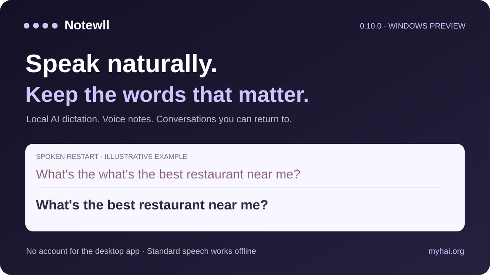
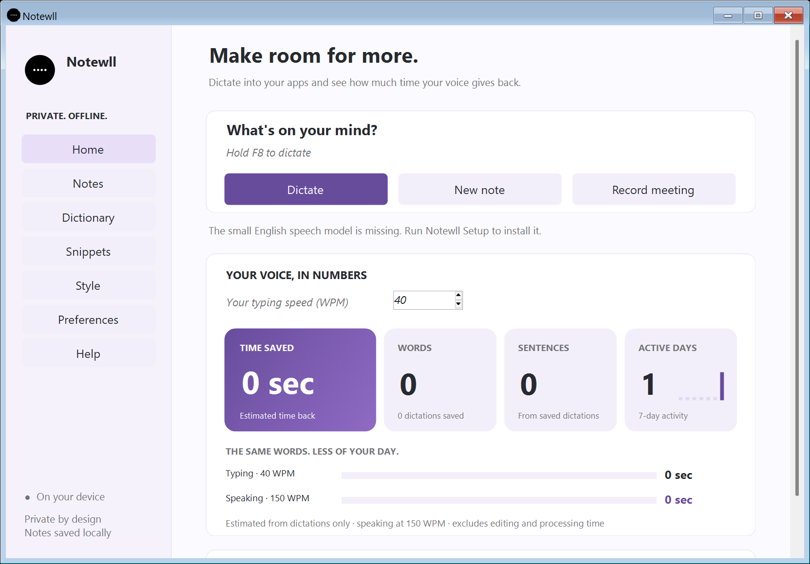
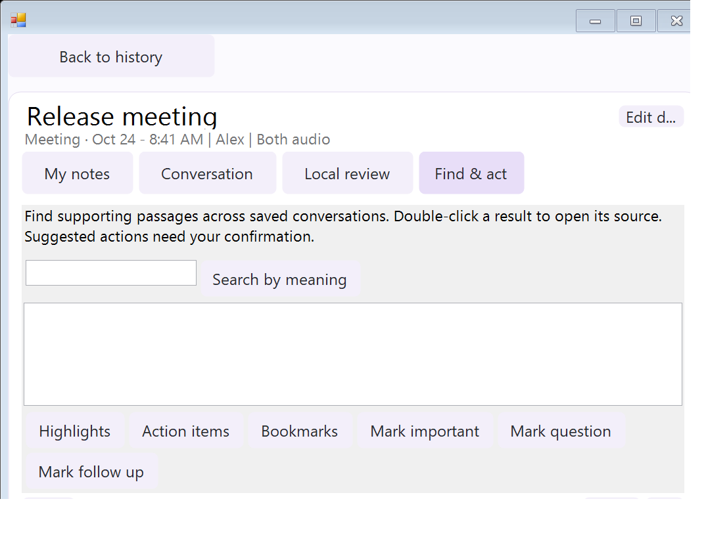
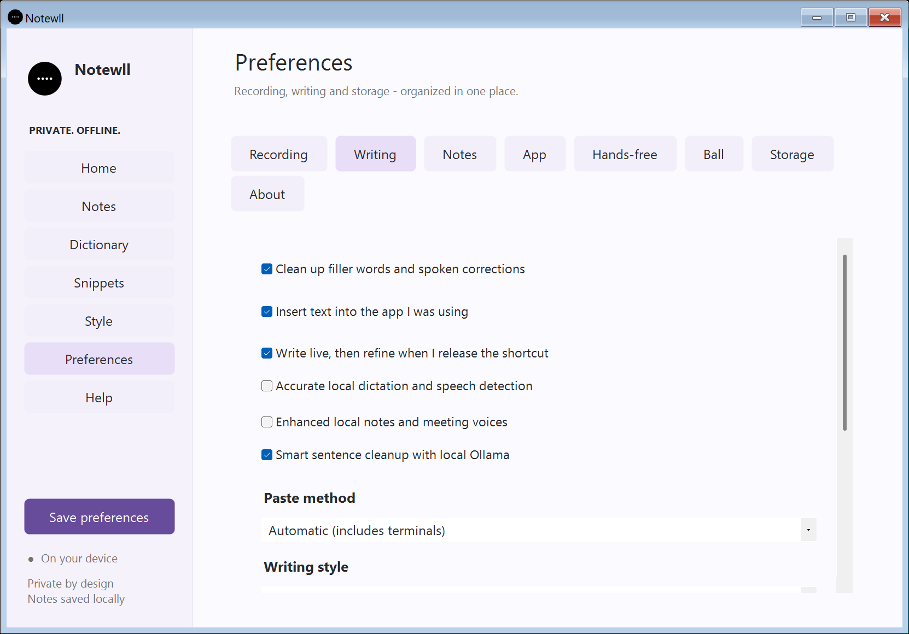

<p align="center"></p>

# Notewll — local AI dictation, voice notes and meeting transcripts for Windows

**Speak naturally. Keep the words that matter.**

Turn speech into text, catch a thought, and return to the conversation. Notewll combines shortcut dictation, personal notes, timestamped meeting recordings and optional local AI sentence cleanup in a native Windows app.



[**Download Windows preview**](https://github.com/sudheer-050/notewll/releases/download/v0.10.0/Notewll-Setup-0.10.0.exe) · [Small update for existing installs](https://github.com/sudheer-050/notewll/releases/download/v0.10.0/Notewll-Small-Update.zip) · [Product and demo](https://myhai.org/projects/dotflow/) · [Portfolio case study](https://sudheerkumargandiboyana.com/projects/dotflow/) · [User guide](USER_GUIDE.md)

**Windows 10/11 x64 · English · 0.10.0 unsigned preview.** The installer includes the standard offline speech engine. AI cleanup, semantic search and voice matching use optional, separately installed local models.

## New: speak through a restart

Natural speech contains restarts. Your written sentence does not need to keep every one.

| You say | Notewll can write |
|---|---|
| “What's the what's the best restaurant near me?” | “What's the best restaurant near me?” |
| “Can you list what are what updates you have done?” | “Can you list what updates you have done?” |
| “I has a meeting tomorrow.” | “I have a meeting tomorrow.” |
| “I just wanted to talk to you about what are what what about the king?” | “I just wanted to talk to you about the king.” |

Basic cleanup detects repeated grammatical phrases, including contracted question words and mixed apostrophe styles, without a language model. **Smart sentence cleanup** uses a locally installed Ollama `llama3.2` model for broader supported sentence repairs. A validator checks proposed edits against the recognized words, protecting substantive words, names, numbers, negation and prepositions. Ambiguous or unsupported rewrites keep the basic result. Code mode and cleanup-off preserve literal wording.


Eight warmed text-only local-model checks measured **144–511 ms per request**. These are a small diagnostic batch, not microphone-to-editor latency, recognition accuracy, or a guarantee for every sentence. The final smart-cleanup wait is capped at four additional seconds; cold startup and optional model setup are separate. [Measured evidence and limits](verification/SMART_SENTENCE_CLEANUP.md).

## One workspace, three ways to capture

- **Voice typing:** focus a text field, hold F8 or your chosen shortcut, speak, then release. Live writing is optional. Raw recognized words and cleaned dictation remain separately available in history.
- **Personal notes:** write a note or record microphone audio, with editable titles, project labels and tags.
- **Meeting notes:** record microphone audio, computer output, or both; retain source audio and timestamped original statements alongside personal annotations.



## Find what you discussed. Jump to the moment.

**Find & act** connects saved conversations to source passages and playback. Optional local semantic search retrieves supporting excerpts; it does not answer open-ended questions or invent missing context. Lightweight highlights select timestamped original passages. Suggested action items show supporting statements, editable owner/date fields and a confirmation step before becoming tasks.

During recording, mark **Important**, **Question** or **Follow up** with Ctrl+Alt+1/2/3. Open bookmarks after recording and jump back to the saved moment. History supports `project:"Apollo release" tag:budget person:Alex` filters.



Semantic retrieval's installation/inference and physical global-shortcut recording still need the acceptance checks listed in the [roadmap verification report](verification/IMPROVEMENT_ROADMAP.md). They are implemented preview features, not validated accuracy claims.

## More control, less friction

| Feature | What changed |
|---|---|
| Hands-free development preview | Enrolled-voice matching, allowed-app list, visible microphone state, Escape to pause, and pause on lock or microphone changes. Starts paused. Voice matching can make mistakes; physical desktop acceptance remains pending. |
| Correction learning | Review confirmed words and snippets, see where a rule applies, edit/remove it for future use, and keep original conversation words. |
| Private PDF sharing | Choose the content scope, preview the exact text, redact a selection, and export. Personal annotations can be excluded. Audio is not included or redacted. |
| Recovery | Opt-in daily local snapshots while the app runs, authenticated encryption tied to the Windows account/PC, and a restore preview that skips existing note IDs. ZIP remains available for migration. |
| Optional features | Inspect separate storage/download/RAM information when measured; install/remove managed semantic-search and voice-matching runtimes while keeping notes. Unknown measurements stay labeled unknown. |
| Your voice, your orbit | Keep the physics-driven floating ball, sports/planet skins, gravity presets, colors/gradients, separate ball/menu sizes, and rotating local images. |



## Install or update

1. Download [Notewll-Setup-0.10.0.exe](https://github.com/sudheer-050/notewll/releases/download/v0.10.0/Notewll-Setup-0.10.0.exe) and the [checksums](https://github.com/sudheer-050/notewll/releases/download/v0.10.0/SHA256SUMS-0.10.0.txt).
2. Finish active recordings, open the installer, choose Install, then Open app. Existing notes and preferences are preserved.
3. Check the microphone in Practice, then test your shortcut in your chosen editor.
4. For AI sentence editing, install Ollama and its `llama3.2` model separately, then enable **Preferences ? Writing ? Smart sentence cleanup** and use **Check local sentence cleanup**. No model is downloaded during dictation.
5. Optional semantic search and voice matching have their own setup paths. The [small update ZIP](https://github.com/sudheer-050/notewll/releases/download/v0.10.0/Notewll-Small-Update.zip) is for existing installations and includes a READ ME; it is not a first-time installer.

Requirements: Windows 10/11 x64, .NET Framework 4.8 and device permission for the selected audio sources. Standard installation and speech do not need Python, Docker, a cloud API key or an account. Additional models/runtimes can require downloads. The preview installer is unsigned; signed automatic updates are not configured.

## Privacy and scope

The Windows app processes speech and notes locally. Dictation audio is held in memory; deliberately recorded notes save audio and text under `%LOCALAPPDATA%\LocalDictation\Notes`. The optional browser demo is separate and may use its browser provider's speech service. Exported PDFs can be edited externally and are not signed evidence. Encrypted snapshots require the same Windows account/PC; keep ZIP backups for migration.

No perfect correction, universal recognition accuracy, voice authentication, or platform-wide cross-app compatibility is claimed. Physical microphone capture and desktop insertion need normal-desktop acceptance. No macOS or mobile build is supplied.

## Build and verify

```powershell
.\scripts\build_setup.ps1
python -m pip install -r requirements-dev.txt
python -m pytest tests -q -k "not live_default_microphone_captures_audio and not live_missing_named_microphone_falls_back_and_still_captures"
```

Source includes the native app, offline installer build, speech workers and regression checks. Generated installers belong in Releases, not the source tree. [Release notes](RELEASE_NOTES.md) · [Technical verification](verification/SMART_SENTENCE_CLEANUP.md) · [Improvement roadmap](IMPROVEMENT_ROADMAP.md) · [Third-party notices](THIRD_PARTY_NOTICES.md).
