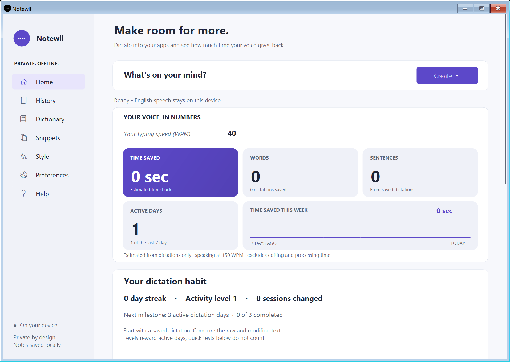
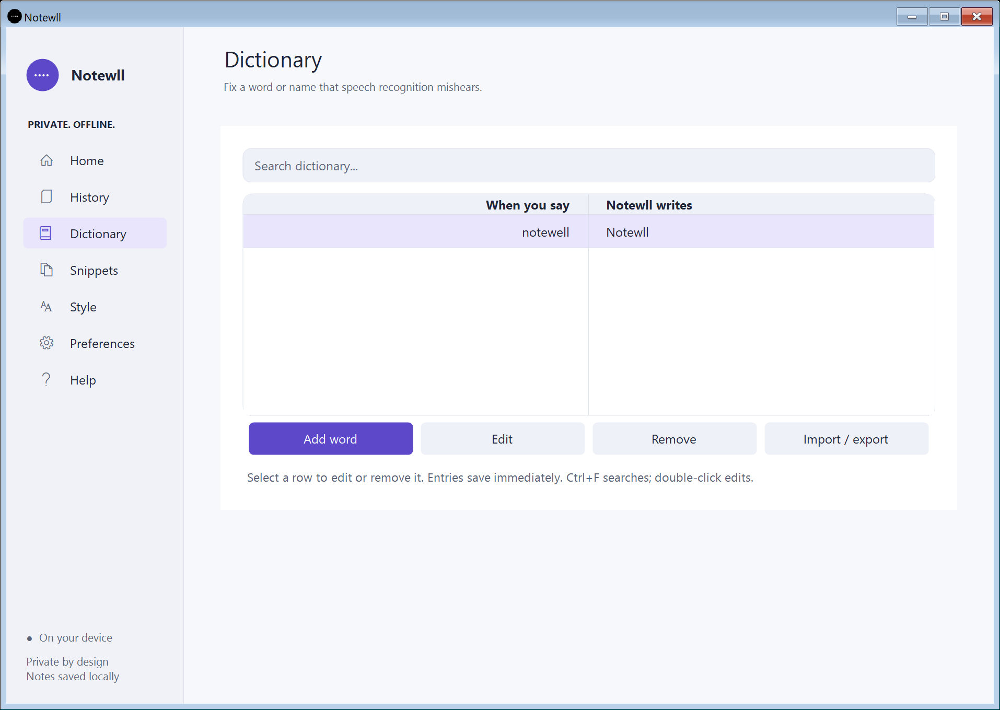
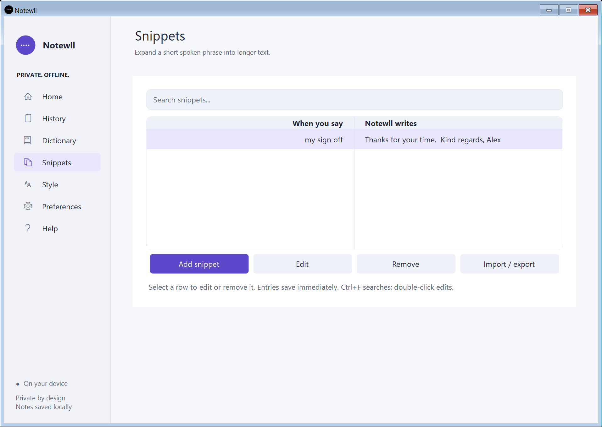

<p align="center"></p>

# Notewll - local dictation, notes and meetings for Windows

Speak into your apps, record a thought, and return to saved conversations. Speech processing and notes stay on your computer.

[**Download Windows preview 0.11.0**](https://github.com/sudheer-050/notewll/releases/download/v0.11.0/Notewll-Setup-0.11.0.exe) ? [Product and demo](https://notewll.myhai.org/) ? [Portfolio case study](https://sudheerkumargandiboyana.com/projects/notewll/) ? [User guide](USER_GUIDE.md)

**Windows 10/11 x64 ? .NET Framework 4.8 ? unsigned preview.** The installer includes standard offline English speech; no account, Python or Docker is needed for that path. Optional local models require separate setup.



## A simpler workspace

- **Create:** Dictate, Note, Meeting or Conversation from one compact Home menu.
- **Analytics:** see estimated time saved, dictated words, sentences and weekly activity without expanding a section.
- **History:** search and filter saved dictations, notes, conversations and meetings. Open entries to review, edit or export.
- **Try Notewll:** use the local editor to compare raw and modified text before copying it.

## Words and phrases that work for you

Dictionary fixes recurring recognized words and names. Snippets expand a short phrase into longer text. Both have a centered search field, a clear two-column table and immediate entry saving. Select a row to edit; select several to remove or export. There are no sort/favorite controls or duplicate sentence-preview sections.




## Local writing controls

Style groups Raw text, Light cleanup and Modified text with Standard, Chat, Email and Code formatting. Raw text bypasses cleanup and replacements. Modified text uses conservative rules for fillers and supported repeated starts; quoted dialogue remains literal. Originals are retained.

App-specific styles are opt-in and match local process names, not browser domains or surrounding text. Formatted snippets support bold, italic, bullets and URL text; exact-trigger formatted paste requires an explicit opt-in. Other apps can accept only the plain-text fallback. Remember a correction lets you review a proposed word correction before saving it.

Voice editing accepts explicit commands such as uppercase, replace X with Y and remove the last sentence, then shows a preview. It does not silently read another application's selection or generate arbitrary prose.

## Notes, meetings and recovery

Capture microphone audio, computer output or both. Review original timestamped statements, search saved work and export a PDF with a text preview. Optional local retrieval supplies supporting passages; it is not open-ended generated Q&A. Local ICS import supports individual timed events and opt-in reminders while the app runs; it never starts recording automatically. Calendar accounts and recurring series are not synchronized.

Notes save atomically and have recovery copies. Optional encrypted snapshots depend on the Windows account/PC; ZIP backups support migration. The customizable floating ball, reduced-motion controls and explicit enrolled-voice hands-free preview remain available.

## Install or update

1. Download [Notewll-Setup-0.11.0.exe](https://github.com/sudheer-050/notewll/releases/download/v0.11.0/Notewll-Setup-0.11.0.exe) and [checksums](https://github.com/sudheer-050/notewll/releases/download/v0.11.0/SHA256SUMS-0.11.0.txt).
2. Finish recordings, close Notewll and run the installer. Existing notes and preferences are preserved.
3. Open Try Notewll and test your microphone; then test dictation in your chosen editor.
4. Set writing behavior on Style. Additional speech languages require Optional features > Set up multilingual speech.

The multilingual Whisper base model is about 145 MB; its Python environment and packages need additional disk/RAM. Models download only during optional setup. The Windows preview is unsigned and does not enable signing-based automatic installation.

## Privacy and acceptance

The Windows app processes speech and notes locally. Deliberately recorded notes retain audio and text in the existing LocalDictation data folder. Compatibility installation identifiers and a LocalDictation.exe alias preserve older shortcuts. The separate browser demo may use its browser provider's speech service.

No universal recognition accuracy, perfect speaker authentication, cross-app compatibility or Microsoft Store certification is claimed. Real microphone/call capture, desktop insertion, multilingual accuracy, mixed-DPI hardware and Narrator require normal-desktop acceptance. Existing experimental macOS source is retained in this repository; this release supplies the Windows installer.

## Build and verify

```powershell
.\scripts\build_setup.ps1
python -m pip install -r requirements-dev.txt
python -m pytest tests -q -k "not test_live_default_microphone_captures_audio and not test_live_missing_named_microphone_falls_back_and_still_captures and not test_transcription_and_gpu_probe_request_hidden_console_windows"
```

Store packaging checks run when a local MSIX has been built with scripts/build_store.ps1. Installers belong in GitHub Releases, not the source tree. Screenshots use demonstration data.

[Release notes](RELEASE_NOTES.md) ? [Release verification](verification/RELEASE_0.11.0.md) ? [Third-party notices](THIRD_PARTY_NOTICES.md).
